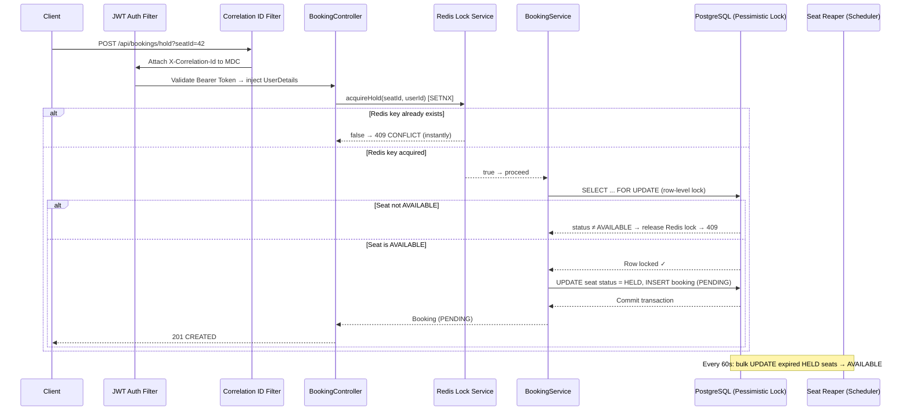
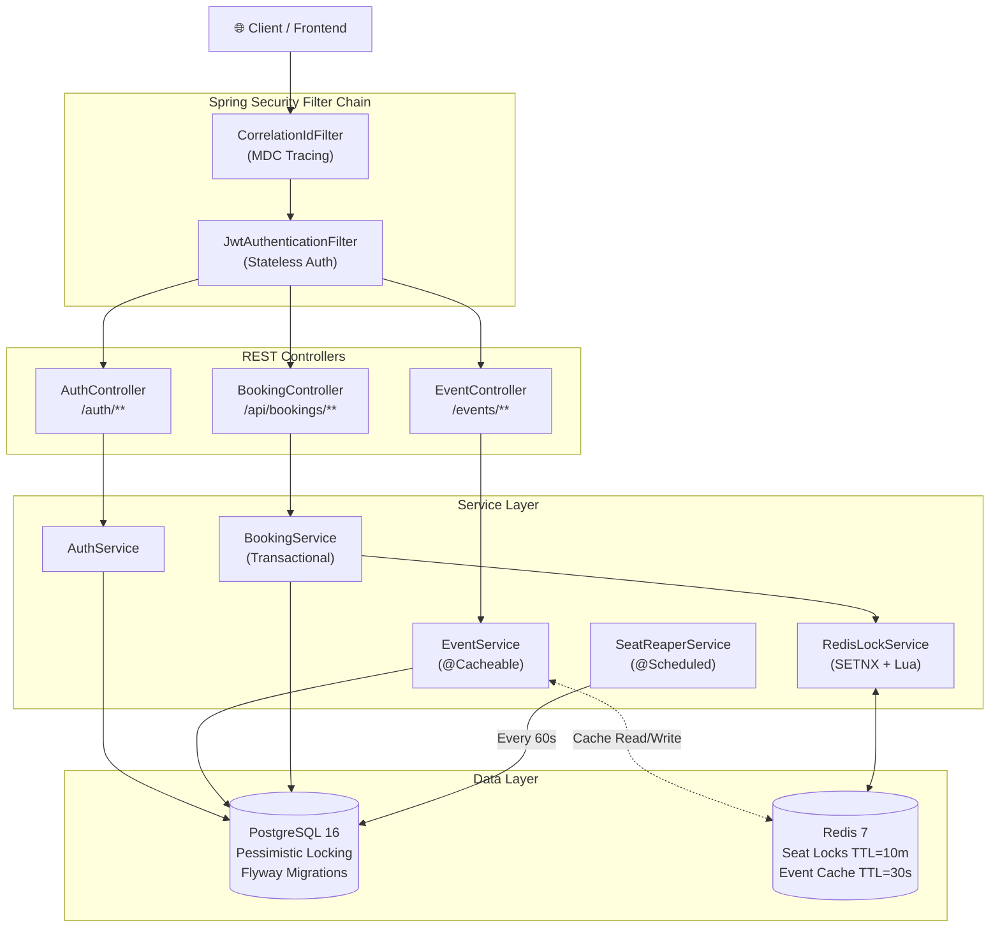
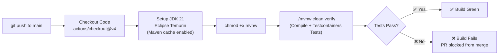
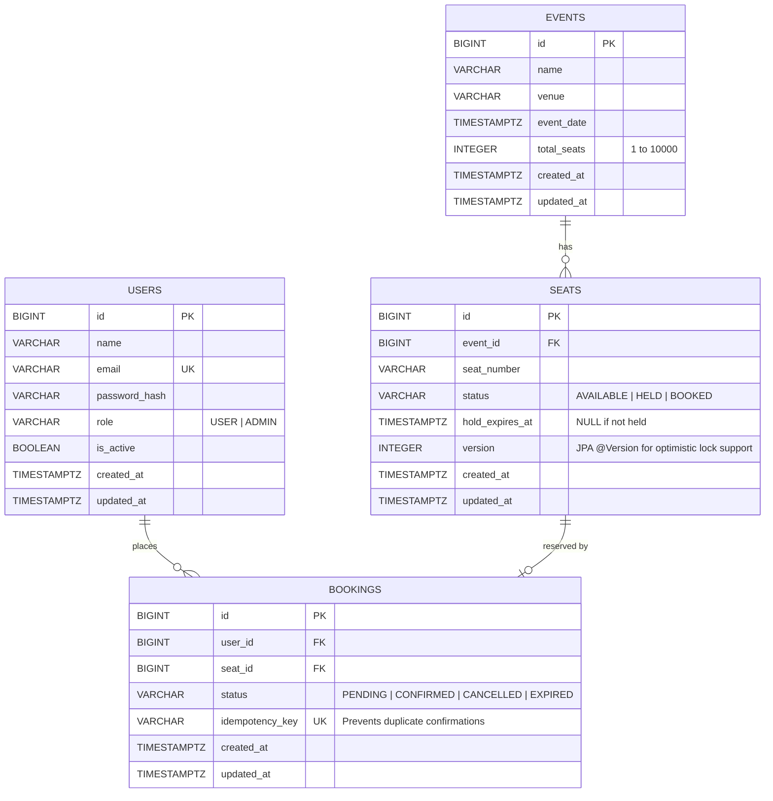

# 🎟️ TicketingApi

<p align="center">
  
  
  
  
  
  
</p>

---

## 📋 Executive Summary

**TicketingApi** is a production-grade, concurrent seat-booking backend built with Spring Boot 4 and Java 21. It exposes a secure REST API for browsing events, holding seats, confirming bookings, and managing cancellations — with every critical path hardened against race conditions.

The core problem it solves is **double-booking under flash-sale traffic**: when hundreds of users simultaneously try to claim the same seat (e.g., a stadium sell-out), naive implementations either corrupt the database or bring it to its knees. This system implements a **two-layer locking strategy** — a Redis SETNX fast-path filter backed by a PostgreSQL pessimistic row-lock — that mathematically guarantees only one user can ever claim a given seat, proven by a 500-thread Testcontainers concurrency stress test.

---

## 🏛️ Core Architecture & System Design

### Request Flow Diagram



### Component Architecture



### Design Trade-offs

| Decision | Chosen Approach | Why Not the Alternative |
|---|---|---|
| **Seat Locking** | Redis SETNX (fast path) + PostgreSQL `SELECT FOR UPDATE` (truth) | **Optimistic locking** would cause thousands of rollbacks and retries under flash-sale load, hammering the DB. Pessimistic locking paired with a Redis pre-filter blocks 499/500 threads before they ever reach Postgres. |
| **Cache** | Redis | **Memcached** lacks native data-structure support (Sorted Sets, Lua scripting) needed for the atomic lock release. Redis also serves dual duty as both the lock store and the response cache. |
| **Lock Release** | Atomic Lua script (`GET` + `DEL` in one command) | A non-atomic `GET` then `DEL` has a race window where another user's lock could be accidentally deleted between the two calls. |
| **Seat Expiry** | Scheduled `@Scheduled` bulk SQL `UPDATE` (SeatReaper) | Fetching every expired seat as a JPA entity (N+1 pattern) and updating them individually would create thousands of DB round-trips for a large venue. One `UPDATE ... WHERE ...` query handles all of them atomically. |
| **Logging** | Log4j2 + MDC `correlationId` | Logback doesn't natively inject structured fields like `correlationId` as cleanly. Log4j2's async appenders and pattern layouts make distributed tracing straightforward. |
| **DB Migrations** | Flyway | Schema is managed as versioned SQL scripts, applied automatically on startup, and validated on every run (`validate-on-migrate: true`), preventing schema drift in production. |
| **Seat List Pagination** | Spring Data `Pageable` on seat queries | Fetching all seats for a 10,000-seat stadium in one query would blow the JVM heap. Paginated results cap memory usage. |

---

## 🛠️ Technology Stack

| Category | Technology | Version / Details |
|---|---|---|
| **Language** | Java | 21 (LTS) |
| **Framework** | Spring Boot | 4.1.1 |
| **Web** | Spring MVC | REST API, Stateless |
| **Security** | Spring Security + JJWT | Stateless JWT, BCrypt |
| **Primary Database** | PostgreSQL | 16-alpine |
| **ORM** | Spring Data JPA / Hibernate | Pessimistic Locking, Batch Inserts |
| **DB Migrations** | Flyway | Versioned SQL, validated on startup |
| **Cache / Lock Store** | Redis | 7-alpine, TTL-based locks + response cache |
| **Logging** | Log4j2 | Structured, MDC-based correlation IDs |
| **Testing** | JUnit 5 + Testcontainers | Real Postgres + Redis in Docker, 500-thread stress test |
| **Build Tool** | Apache Maven | Maven Wrapper (`mvnw`) |
| **Containerization** | Docker + Docker Compose | Multi-stage build, health-checked orchestration |
| **CI** | GitHub Actions | Auto-build and test on every push to `main` |
| **Code Generation** | Lombok | Boilerplate reduction |

---

## ⚡ Core Features & Capabilities

- **🔐 Stateless JWT Authentication** — JJWT 0.12.5 issues signed tokens on login/register. User roles (`USER`, `ADMIN`) are embedded in the JWT payload. The `JwtAuthenticationFilter` validates every request without any server-side session state.


- **🛡️ Role-Based Access Control** — Spring Security `SecurityFilterChain` enforces that only `ADMIN` users can `POST /events` to create events. All booking routes require authentication. Auth endpoints are publicly open.


- **⚔️ Two-Layer Concurrency Control** — `holdSeat` runs a Redis `SETNX` fast-path check first (O(1), sub-millisecond), instantly rejecting duplicate requests. If Redis grants entry, a PostgreSQL `SELECT ... FOR UPDATE` row-level pessimistic lock is acquired, making the final decision — a mathematically correct double-barrier against double-booking.


- **🔑 Atomic Lua Lock Release** — `releaseHold` uses a Redis Lua script to atomically `GET` and conditionally `DEL` the lock key in a single server-side operation. This prevents the classic race condition of releasing another user's lock.


- **👻 Ghost Lock Prevention** — If the PostgreSQL transaction fails after Redis grants the lock (e.g., database error), the `catch` block immediately releases the Redis key, so the seat is never permanently stuck in a "phantom held" state.


- **🧨 Idempotency Engine** — The `confirmBooking` endpoint accepts an `Idempotency-Key` request header. Duplicate confirmation requests (e.g., from network retries after a timeout) return the already-confirmed booking rather than attempting a double-charge, guaranteed by a `UNIQUE` constraint on the `idempotency_key` column.


- **⏰ Automated Seat Reaper** — `SeatReaperService` wakes up every 60 seconds and executes a single bulk SQL `UPDATE` to flip all expired `HELD` seats back to `AVAILABLE`, freeing inventory without N+1 queries or JVM heap pressure.


- **📦 Batch Seat Generation** — When an ADMIN creates an event with `totalSeats: 500`, the service generates and batch-inserts all 500 `Seat` rows in a single Postgres roundtrip, powered by `reWriteBatchedInserts=true` and Hibernate's `batch_size: 100`.


- **🗂️ Redis Response Cache** — `getAllEvents()` is annotated with `@Cacheable(value = "events")` with a 30-second TTL, absorbing read spikes during flash sales. The cache is immediately invalidated with `@CacheEvict` the moment a new event is created.


- **📄 Paginated Seat Listings** — `GET /events/{eventId}/seats` uses Spring Data `Pageable` (default page size: 100) to prevent out-of-memory crashes when querying large venues.


- **🔍 Distributed Request Tracing** — `CorrelationIdFilter` reads or generates an `X-Correlation-Id` UUID for every incoming HTTP request and injects it into the Log4j2 MDC context, so every log line in a request's lifecycle is traceable end-to-end.


- **📐 DTO-Based Mass Assignment Prevention** — The `EventCreateRequest` DTO explicitly whitelists only `name`, `venue`, `eventDate`, and `totalSeats`. The raw `Event` JPA entity is never accepted from the request body, closing the mass-assignment vulnerability.

---

## 🌐 API Reference

### Authentication — `/auth`

| Method | Endpoint | Auth Required | Description |
|---|---|---|---|
| `POST` | `/auth/register` | ❌ Public | Register a new user. Returns a JWT token. |
| `POST` | `/auth/login` | ❌ Public | Authenticate an existing user. Returns a JWT token. |

**Register / Login Request Body:**
```json
// POST /auth/register
{
  "name": "Barath Jogi",
  "email": "barathjogi.bm@gmail.com",
  "password": "securepassword"
}

// POST /auth/login
{
  "email": "barathjogi.bm@gmail.com",
  "password": "securepassword"
}
```

**Response (both):**
```json
{
  "token": "eyJhbGciOiJIUzI1NiJ9..."
}
```

---

### Events — `/events`

| Method | Endpoint | Auth Required | Description |
|---|---|---|---|
| `GET` | `/events` | ✅ Any authenticated user | List all upcoming events (Redis-cached, 30s TTL). |
| `GET` | `/events/{eventId}/seats` | ✅ Any authenticated user | Paginated list of seats for an event. `?page=0&size=100` |
| `POST` | `/events` | 🔒 `ADMIN` only | Create an event and auto-generate all its seats. |

**Create Event Request Body (ADMIN):**
```json
{
  "name": "Champions League Final",
  "venue": "Wembley Stadium",
  "eventDate": "2027-05-28T20:00:00+00:00",
  "totalSeats": 90000
}
```

---

### Bookings — `/api/bookings`

> All booking endpoints require a valid `Authorization: Bearer <token>` header.

| Method | Endpoint | Auth Required | Special Header | Description |
|---|---|---|---|---|
| `GET` | `/api/bookings` | ✅ Authenticated user | — | Get the authenticated user's booking history. |
| `POST` | `/api/bookings/hold?seatId={id}` | ✅ Authenticated user | — | Acquire a 10-minute hold on a seat (two-layer lock). Returns `PENDING` booking. |
| `POST` | `/api/bookings/{bookingId}/confirm` | ✅ Authenticated user | `Idempotency-Key: <uuid>` | Confirm a held booking. Idempotent on retry. Marks seat as `BOOKED`. |
| `POST` | `/api/bookings/{bookingId}/cancel` | ✅ Authenticated user | — | Cancel a `PENDING` hold. Releases both the DB record and the Redis lock. |

---

## 🚀 Local Development Setup

### Prerequisites

| Tool | Required Version |
|---|---|
| Java (JDK) | **21** (Eclipse Temurin recommended) |
| Docker Desktop | Latest stable |
| Git | Any recent version |
| Maven | Bundled via `mvnw` — no install needed |

---

### Option A: Full Docker Setup (Recommended — Zero Config)

Spins up the API, PostgreSQL, and Redis together. Flyway migrations run automatically on startup.

```bash
# 1. Clone the repository
git clone https://github.com/BarathJogi/TicketingApi.git
cd TicketingApi

# 2. Build and start all three services
docker compose up --build

# API is now live at http://localhost:8080
```

To stop and remove containers:
```bash
docker compose down
```

---

### Option B: Local IDE Run (Spring Boot Dev Mode)

For development with hot-reload. Requires Docker Desktop running (Spring Boot auto-starts the compose services).

```bash
# 1. Clone the repository
git clone https://github.com/BarathJogi/TicketingApi.git
cd TicketingApi

# 2. Run the app — Spring Boot Docker Compose support auto-starts
#    PostgreSQL and Redis from compose.yaml
./mvnw spring-boot:run       # Linux / macOS
mvnw.cmd spring-boot:run     # Windows

# API is now live at http://localhost:8080
```

---

### Environment Variables

The application uses environment variables with safe local defaults baked into `application.yaml`. No `.env` file is needed for local development.

| Variable | Default | Description |
|---|---|---|
| `DB_HOST` | `localhost` | PostgreSQL host |
| `DB_USERNAME` | `postgres` | PostgreSQL username |
| `DB_PASSWORD` | `jogidb` | PostgreSQL password |
| `REDIS_HOST` | `localhost` | Redis host |
| `REDIS_PORT` | `6379` | Redis port |
| `jwt.secret` | (default dev key) | **MUST be overridden in production** with a 256-bit Base64 key |
| `jwt.expiration` | `86400000` | Token TTL in milliseconds (default: 24 hours) |

> [!CAUTION]
> **Never deploy the default `jwt.secret` to production.** Generate a secure secret with:
> ```bash
> openssl rand -base64 32
> ```
> Then set it as an environment variable: `JWT_SECRET=<your-generated-key>`

---

## 🧪 Testing Strategy

### Run the Full Test Suite

```bash
./mvnw clean verify       # Linux / macOS
mvnw.cmd clean verify     # Windows
```

This command compiles the project, spins up **real** Docker containers via Testcontainers, executes all tests against them, and tears them down automatically.

> [!IMPORTANT]
> Docker Desktop must be running before executing tests. Testcontainers pulls `postgres:16-alpine` and `redis:7-alpine` automatically.

---

### What's Being Tested

#### `BookingServiceConcurrencyTest` — The Crown Jewel

| Metric | Value |
|---|---|
| Concurrent threads | **500** |
| Strategy | `ExecutorService` + `CountDownLatch` start-gun pattern |
| Infrastructure | Real PostgreSQL + Real Redis (Testcontainers) |
| Assertion | Exactly **1 success**, exactly **499 failures** |
| State verified | Seat status = `HELD`, booking count = `1` |

This test mathematically proves the two-layer locking strategy is correct. All 500 threads are pre-loaded and released simultaneously via a `CountDownLatch`, creating the most adversarial possible concurrency scenario. The `@AfterEach` teardown flushes both the Redis DB and all PostgreSQL tables to prevent test-state bleed.

#### Integration Test Infrastructure

The `TestcontainersConfiguration` class uses `@ServiceConnection` to wire a real `PostgreSQLContainer` and a real `GenericContainer` (Redis) directly into the Spring application context — no mocking, no in-memory substitutes.

```
📦 src/test/
├── TestcontainersConfiguration.java   ← Real Postgres + Redis container wiring
├── TestTicketingApiApplication.java   ← Test application entry point
└── service/
    └── BookingServiceConcurrencyTest.java  ← 500-thread race condition proof
```

---

## ⚙️ CI/CD Pipeline

The GitHub Actions workflow at [`.github/workflows/ci.yml`](.github/workflows/ci.yml) triggers on every `push` and `pull_request` to the `main` branch.



**Pipeline Steps:**
1. **Checkout** — Fetches the full repository.
2. **JDK Setup** — Installs Temurin JDK 21 with Maven dependency caching (speeds up subsequent runs).
3. **Wrapper Permission** — `chmod +x ./mvnw` ensures the Maven wrapper is executable on the Ubuntu runner.
4. **Build & Test** — `./mvnw clean verify` compiles the source, starts Testcontainers (Docker is pre-installed on `ubuntu-latest`), runs the full integration test suite including the 500-thread concurrency stress test, and fails the build if any assertion breaks.

> [!NOTE]
> Docker is available by default on GitHub's `ubuntu-latest` runners, making Testcontainers-based integration tests work seamlessly in CI without any extra setup.

---

## 🗄️ Database Schema & Data Model

### Entity Relationship Diagram



### Key Schema Design Decisions

| Constraint | Table | Purpose |
|---|---|---|
| `UNIQUE (event_id, seat_number)` | `seats` | Prevents creating the same seat number twice for the same event. |
| `UNIQUE (idempotency_key)` | `bookings` | Database-level guarantee that no idempotency key is ever reused, even under concurrent retries. |
| `CHECK (status IN (...))` | `seats`, `bookings` | Postgres-level enum enforcement — invalid status values are rejected at the DB layer. |
| `ON DELETE CASCADE` | `seats → events` | Deleting an event automatically cleans up all its seats. |
| `ON DELETE RESTRICT` | `bookings → users/seats` | Prevents orphaned bookings by blocking deletion of a user/seat that has a booking. |
| `version INTEGER DEFAULT 0` | `seats` | Required for JPA `@Version` / optimistic locking support and Hibernate batch update compatibility (`batch_versioned_data: true`). |

### Flyway Migration Strategy

Flyway is configured with `validate-on-migrate: true`. On every application startup, Flyway:
1. Checks the `flyway_schema_history` table in Postgres.
2. Applies any new migration scripts found in `src/main/resources/db/migration/` (e.g., `V1__init_schema.sql`).
3. **Validates** that previously applied scripts have not been modified — if they have, the application refuses to start, preventing silent schema corruption.

New schema changes should be added as new versioned files: `V2__add_column_x.sql`, `V3__create_table_y.sql`, etc. Never edit a migration that has already been applied.

---

## 👨‍💻 Author

<table>
  <tr>
    <td align="center">
      <strong>Barath Jogi</strong><br/>
      <em>Backend Engineer</em><br/><br/>
      <a href="http://www.linkedin.com/in/barath-jogi">🔗 LinkedIn</a> &nbsp;|&nbsp;
      <a href="https://github.com/BarathJogi">🐙 GitHub</a> &nbsp;|&nbsp;
      <a href="mailto:barathjogi.bm@gmail.com">📧 barathjogi.bm@gmail.com</a>
    </td>
  </tr>
</table>
