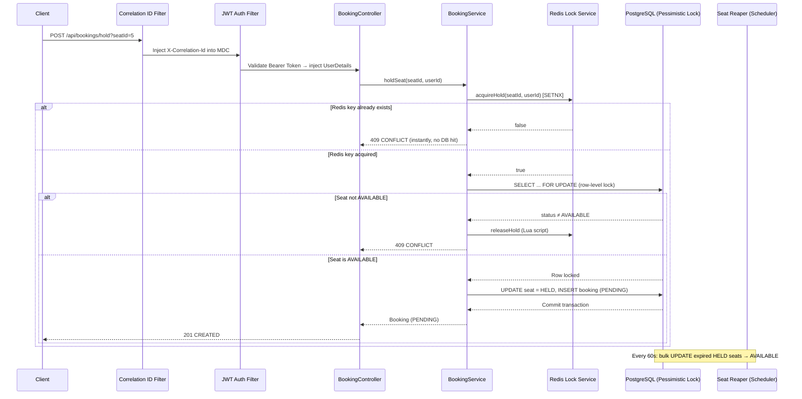
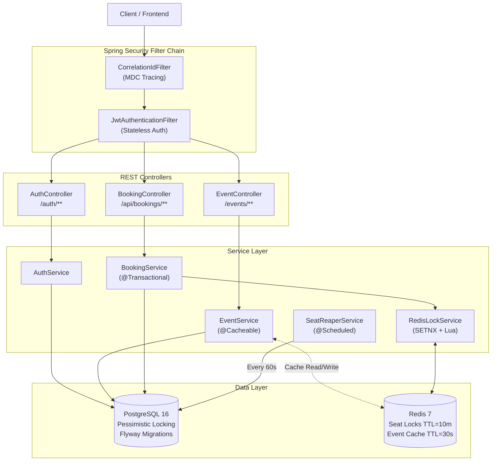
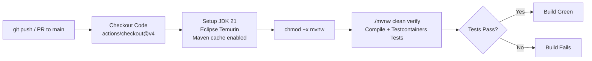
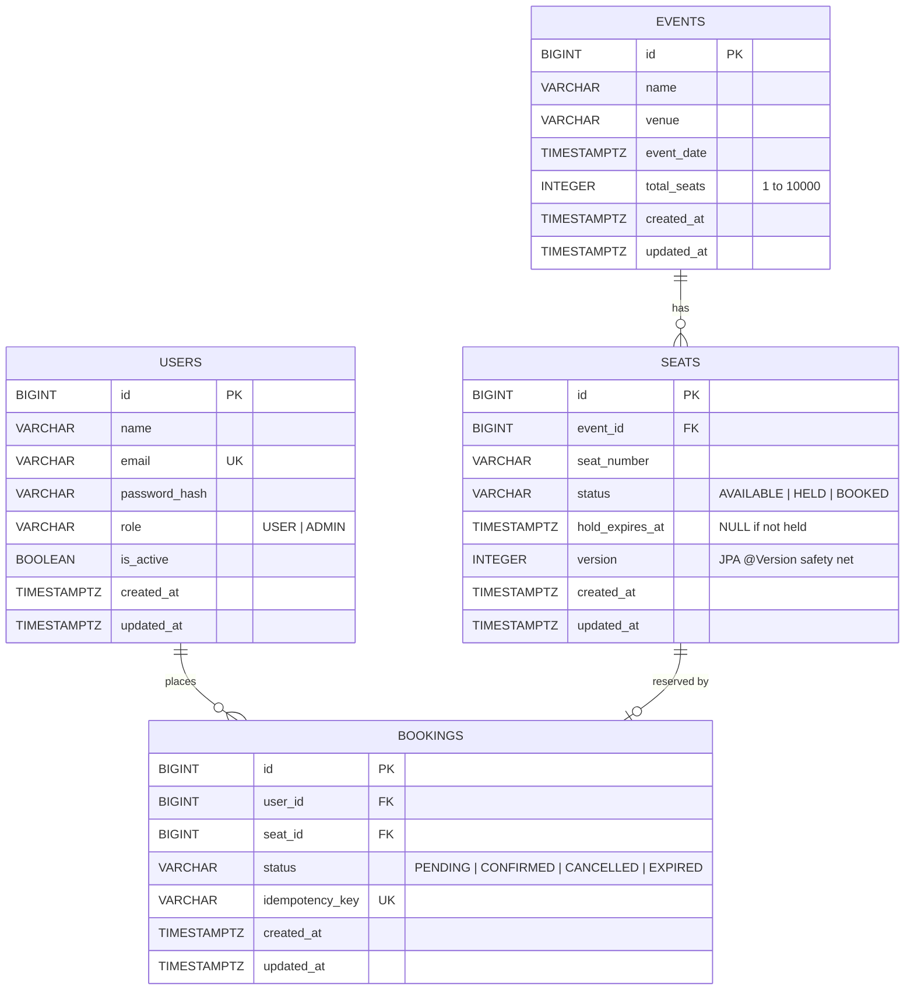
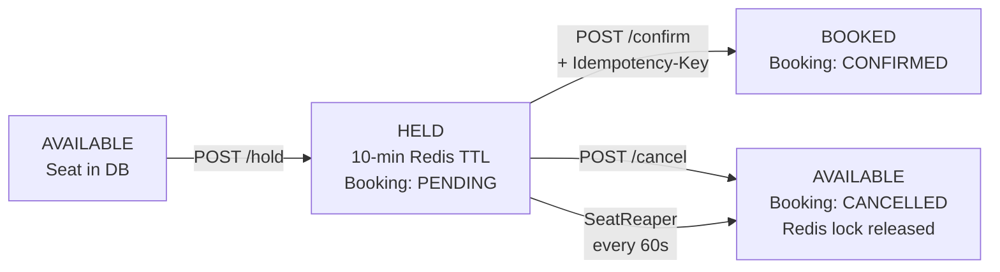

# TicketingApi

<p align="center">
  
  
  
  
  
  
</p>

<p align="center">
  <a href="https://github.com/BarathJogi/TicketingApi/actions/workflows/ci.yml">
    
  </a>
</p>

---

## Executive Summary

**TicketingApi** is a production-style, concurrent seat-booking backend built with Spring Boot 4 and Java 21. It exposes a secure REST API for browsing events, holding seats, confirming bookings, and managing cancellations — with the seat-hold path protected against race conditions.

The core problem it solves is **double-booking under flash-sale traffic**: when hundreds of users simultaneously try to claim the same seat, naive implementations either corrupt the database or bring it to its knees. This system implements a **two-layer locking strategy** — a Redis SETNX fast-path filter backed by a PostgreSQL pessimistic row-lock — verified by a 500-thread Testcontainers concurrency stress test to allow exactly one successful hold per seat.

---

## Core Architecture & System Design

### Request Flow — Hold a Seat



### Component Architecture



### Design Trade-offs

| Decision | Chosen Approach | Rationale |
|---|---|---|
| **Seat Locking** | Redis SETNX (fast path) + PostgreSQL `SELECT FOR UPDATE` (source of truth) | Optimistic locking causes rollbacks and retries on every collision — under flash-sale load with hundreds of concurrent requests on the same row, that becomes a retry storm. Pessimistic locking acquires the row immediately and serialises writers cleanly. Redis acts as a pre-filter to absorb the bulk of concurrent requests before they reach Postgres. |
| **`@Version` on `Seat`** | Kept as a safety net; pessimistic locking is the active strategy | If a future code path updates a seat without the locked query, the version check rejects a stale write instead of silently overwriting it. |
| **Cache** | Redis | Redis serves dual duty — distributed lock store and response cache — in a single dependency. It also supports atomic Lua scripting needed for the lock release. |
| **Lock Release** | Atomic Lua script (`GET` + conditional `DEL`) | A non-atomic `GET` then `DEL` has a race window where another user's lock could be deleted between the two calls. The Lua script executes both atomically on the Redis server side. |
| **Seat Expiry** | `@Scheduled` bulk SQL `UPDATE` (SeatReaper) | Fetching expired seats as JPA entities (N+1) and updating them one by one would create one `UPDATE` per row. A single `UPDATE ... WHERE status = 'HELD' AND hold_expires_at < :now` handles all of them in one query. |
| **Logging** | Log4j2 + MDC `correlationId` | Log4j2 was chosen to gain experience with its async appender configuration and pattern layout syntax. Both Log4j2 and Logback support MDC natively — this is a learning preference, not a technical limitation of the alternative. |
| **DB Migrations** | Flyway | Schema is managed as versioned SQL scripts applied automatically on startup. `validate-on-migrate: true` ensures previously applied scripts have not been tampered with, preventing silent schema drift. |
| **Seat List Pagination** | Spring Data `Pageable` (default page size: 100) | Fetching all seats for a 10,000-seat venue in one query could exhaust JVM heap. Paginated queries cap memory usage regardless of venue size. |

---

## Technology Stack

| Category | Technology | Version / Details |
|---|---|---|
| **Language** | Java | 21 (LTS) |
| **Framework** | Spring Boot | 4.1.1 |
| **Web** | Spring MVC | REST API, Stateless |
| **Security** | Spring Security + JJWT | Stateless JWT (HS384), BCrypt password hashing |
| **Primary Database** | PostgreSQL | 16-alpine |
| **ORM** | Spring Data JPA / Hibernate | Pessimistic locking |
| **DB Migrations** | Flyway | Versioned SQL, validated on startup |
| **Cache / Lock Store** | Redis | 7-alpine, TTL-based locks + response cache |
| **Logging** | Log4j2 | Structured pattern layout, MDC-based correlation IDs |
| **Testing** | JUnit 5 + Testcontainers | Real Postgres + Redis in Docker, 500-thread concurrency test |
| **Build Tool** | Apache Maven | Maven Wrapper (`mvnw`) |
| **Containerization** | Docker + Docker Compose | Multi-stage build, health-checked orchestration |
| **CI** | GitHub Actions | Build and test on every push/PR to `main` |
| **Code Generation** | Lombok | Boilerplate reduction |

---

## Core Features & Capabilities

- **Stateless JWT Authentication** — JJWT 0.12.5 issues HS384-signed tokens on login and register. User roles (`USER`, `ADMIN`) are embedded in the token payload. The `JwtAuthenticationFilter` validates every request without any server-side session state.

- **Role-Based Access Control** — Spring Security `SecurityFilterChain` restricts `POST /events` to `ADMIN` users only. All booking routes require authentication. Auth endpoints are publicly open.

- **Two-Layer Concurrency Control** — `holdSeat` runs a Redis `SETNX` fast-path check first (O(1)), instantly rejecting concurrent duplicate requests. If Redis grants entry, a PostgreSQL `SELECT ... FOR UPDATE` row-level pessimistic lock is acquired, making the final authoritative decision. The 500-thread concurrency test verifies that exactly one hold succeeds per seat.

- **Atomic Lua Lock Release** — `releaseHold` uses a Redis Lua script to atomically `GET` and conditionally `DEL` the lock key in a single server-side operation, preventing the race condition of accidentally releasing another user's lock.

- **Ghost Lock Prevention** — If the PostgreSQL transaction fails after Redis grants the lock, the `catch` block immediately calls `releaseHold`, so the seat does not remain stuck for 10 minutes due to an orphaned Redis key.

- **Idempotent Booking Confirmation** — `confirmBooking` checks whether a booking is already `CONFIRMED` and the supplied `Idempotency-Key` matches the stored key. If so, it returns the existing booking immediately without re-executing the update. The `UNIQUE` constraint on `idempotency_key` provides an additional database-level guard against duplicate writes.

- **Automated Seat Reaper** — `SeatReaperService` wakes up every 60 seconds and executes a single bulk SQL `UPDATE` to flip all expired `HELD` seats back to `AVAILABLE`, freeing inventory without N+1 queries.

- **Seat Generation** — When an ADMIN creates an event, all seat rows are generated and saved with `saveAll` in a single transaction.

- **Redis Response Cache** — `getAllEvents()` is annotated `@Cacheable(value = "events")` with a 30-second TTL. The cache is immediately invalidated with `@CacheEvict` when a new event is created.

- **Paginated Seat Listings** — `GET /events/{eventId}/seats` uses Spring Data `Pageable` (default: 100 per page) to prevent out-of-memory errors on large venues.

- **Distributed Request Tracing** — `CorrelationIdFilter` reads or generates an `X-Correlation-Id` UUID per request and injects it into the Log4j2 MDC context, so every log line in a request's lifecycle shares the same trace ID. The ID is also echoed back in the response header.

- **DTO-Based Mass Assignment Prevention** — `EventCreateRequest` explicitly whitelists only `name`, `venue`, `eventDate`, and `totalSeats`. The `Event` JPA entity is never accepted directly from the request body. The `role` field on `RegisterRequest` is similarly ignored — users are always created as `USER` on the server side.

---

## API Reference

### Authentication — `/auth`

| Method | Endpoint | Auth | Description |
|---|---|---|---|
| `POST` | `/auth/register` | Public | Register a new user (always created as `USER`). Returns a JWT. |
| `POST` | `/auth/login` | Public | Authenticate and receive a JWT. |

**Request body (register):**
```json
{
  "name": "Alice Example",
  "email": "alice@example.com",
  "password": "SecurePass123"
}
```

**Request body (login):**
```json
{
  "email": "alice@example.com",
  "password": "SecurePass123"
}
```

**Response — both endpoints:**
```json
{ "token": "eyJhbGciOiJIUzM4NCJ9..." }
```

---

### Events — `/events`

| Method | Endpoint | Auth | Description |
|---|---|---|---|
| `GET` | `/events` | Any authenticated user | List upcoming events (Redis-cached, 30s TTL). |
| `GET` | `/events/{eventId}/seats` | Any authenticated user | Paginated seat list. `?page=0&size=100` |
| `POST` | `/events` | `ADMIN` only | Create event and auto-generate all seat rows. |

**Create event request body (ADMIN):**
```json
{
  "name": "Champions League Final",
  "venue": "Wembley Stadium",
  "eventDate": "2027-05-28T20:00:00Z",
  "totalSeats": 500
}
```

> `totalSeats` is validated as `1–10000` at both the DTO and entity layer. Values outside this range return `400 Bad Request`.

---

### Bookings — `/api/bookings`

> All booking endpoints require `Authorization: Bearer <token>`.

| Method | Endpoint | Auth | Special Header | Description |
|---|---|---|---|---|
| `GET` | `/api/bookings` | Authenticated | — | Authenticated user's booking history. |
| `POST` | `/api/bookings/hold?seatId={id}` | Authenticated | — | Acquire a 10-minute hold. Returns `PENDING` booking. |
| `POST` | `/api/bookings/{bookingId}/confirm` | Authenticated | `Idempotency-Key: <string>` | Confirm a held booking. Idempotent on retry. Marks seat `BOOKED`. |
| `POST` | `/api/bookings/{bookingId}/cancel` | Authenticated | — | Cancel a `PENDING` hold. Releases DB record and Redis lock. |

---

## Local Development Setup

### Prerequisites

| Tool | Required Version |
|---|---|
| Java (JDK) | **21** (Eclipse Temurin recommended) |
| Docker Desktop | Latest stable |
| Git | Any recent version |
| Maven | Bundled via `mvnw` — no install needed |

---

### Option A: Full Docker Setup (Recommended)

Spins up the API, PostgreSQL, and Redis together. Flyway migrations run automatically on startup.

```bash
# 1. Clone the repository
git clone https://github.com/BarathJogi/TicketingApi.git
cd TicketingApi

# 2. Build the image and start all three services
docker compose up -d --build

# 3. Tail logs to confirm Flyway applied V1__init_schema.sql and the app started
docker logs -f ticketing-api

# API is live at http://localhost:8080
```

To stop and tear down:
```bash
docker compose down          # stop, keep volumes
docker compose down -v       # stop and wipe volumes (clean slate)
```

---

### Option B: Local IDE Run

For development. Requires Docker Desktop running — Spring Boot's Docker Compose integration auto-starts PostgreSQL and Redis from `compose.yaml`.

```bash
git clone https://github.com/BarathJogi/TicketingApi.git
cd TicketingApi

./mvnw spring-boot:run       # Linux / macOS
mvnw.cmd spring-boot:run     # Windows
```

---

### Environment Variables

Defaults in `application.yaml` are sufficient for local development. No `.env` file is needed.

| Variable | Default | Description |
|---|---|---|
| `DB_HOST` | `localhost` | PostgreSQL host |
| `DB_USERNAME` | `postgres` | PostgreSQL username |
| `DB_PASSWORD` | `jogidb` | PostgreSQL password |
| `REDIS_HOST` | `localhost` | Redis host |
| `REDIS_PORT` | `6379` | Redis port |
| `jwt.secret` | (dev key) | **Override in production.** Must be a Base64-encoded key of at least 48 bytes (384 bits). |
| `jwt.expiration` | `86400000` | Token TTL in milliseconds (default: 24 hours). |

> [!CAUTION]
> Never deploy the default `jwt.secret` to production. Generate a replacement with:
> ```bash
> openssl rand -base64 48
> ```

---

## Testing Strategy

### Run the Test Suite

```bash
./mvnw clean verify       # Linux / macOS
mvnw.cmd clean verify     # Windows
```

Testcontainers spins up real `postgres:16-alpine` and `redis:7-alpine` Docker containers, runs all tests against them, and tears them down automatically.

> [!IMPORTANT]
> Docker Desktop must be running before executing tests.

---

### Test Coverage

#### `BookingServiceConcurrencyTest`

| Metric | Value |
|---|---| 
| Concurrent threads | 500 |
| Strategy | `ExecutorService` + `CountDownLatch` start-gun pattern |
| Infrastructure | Real PostgreSQL + Real Redis (Testcontainers) |
| Assertion | Exactly 1 success, exactly 499 failures |
| State verified | Seat status = `HELD`, booking count = `1` |

All 500 threads are pre-loaded and released simultaneously via `CountDownLatch`. The test verifies that the two-layer locking strategy allows exactly one hold to succeed. The `@AfterEach` teardown flushes Redis and wipes all PostgreSQL tables to prevent state bleeding between test runs.

Note: because all 500 threads target the same `userId`, most are rejected at the Redis layer. A test that bypasses `RedisLockService` and exercises `SELECT FOR UPDATE` alone would more directly prove the database layer is the final source of truth — that remains a gap in the current test suite.

#### Integration Infrastructure

`TestcontainersConfiguration` uses `@ServiceConnection` to wire a real `PostgreSQLContainer` and `GenericContainer` (Redis) directly into the Spring application context — no mocking or in-memory substitutes.

```
src/test/
├── TestcontainersConfiguration.java      ← Real Postgres + Redis container wiring
├── TestTicketingApiApplication.java      ← Test application entry point
└── service/
    └── BookingServiceConcurrencyTest.java ← 500-thread concurrency test
```

---

## CI/CD Pipeline

The workflow at [`.github/workflows/ci.yml`](.github/workflows/ci.yml) triggers on every push and pull request to `main`.



**Steps:**
1. **Checkout** — Fetches the full repository.
2. **JDK Setup** — Installs Temurin JDK 21 with Maven dependency caching.
3. **Wrapper Permission** — `chmod +x ./mvnw` ensures the wrapper is executable on the Ubuntu runner.
4. **Build & Test** — `./mvnw clean verify` compiles, starts Testcontainers (Docker is pre-installed on `ubuntu-latest`), and runs the full integration test suite.

> [!NOTE]
> To have failing tests block pull request merges automatically, enable branch protection rules on `main` in GitHub → Settings → Branches.

---

## Database Schema & Data Model

### Entity Relationship Diagram



### Key Schema Decisions

| Constraint | Table | Purpose |
|---|---|---|
| `UNIQUE (event_id, seat_number)` | `seats` | Prevents duplicate seat numbers within the same event. |
| `UNIQUE (idempotency_key)` | `bookings` | Database-level guard against duplicate booking writes. |
| `CHECK (status IN (...))` | `seats`, `bookings` | Postgres-level enum enforcement — invalid states are rejected at the DB layer. |
| `ON DELETE CASCADE` | `seats → events` | Deleting an event automatically cleans up all its seats. |
| `ON DELETE RESTRICT` | `bookings → users/seats` | Prevents deletion of a user or seat that has associated bookings. |
| `version INTEGER DEFAULT 0` | `seats` | Backs JPA @Version, a safety net against stale updates. |

### Flyway Migration Strategy

Flyway is configured with `validate-on-migrate: true`. On every startup it:
1. Checks the `flyway_schema_history` table in Postgres.
2. Applies any new scripts found in `src/main/resources/db/migration/`.
3. Validates that previously applied scripts have not been modified — if they have, the application refuses to start.

Add schema changes as new versioned files (`V2__...sql`, `V3__...sql`). Never edit a script that has already been applied to any environment.

---

## End-to-End API Walkthrough

Complete flow from a clean stack to a confirmed booking, as run in Postman.

> [!NOTE]
> Sample output; IDs and timestamps will differ on your machine.
> All commands assume Docker Desktop is running and you are in the project root directory.

---

### Step 1 — Start the Stack

```bash
# Wipe any previous state for a clean run
docker compose down -v

# Build the image and start PostgreSQL, Redis, and the API
docker compose up -d --build

# Watch logs until Flyway applies V1__init_schema.sql and Spring Boot starts
docker logs -f ticketing-api
```

The API is ready when you see the Spring Boot startup banner. Base URL: `http://localhost:8080`

---

### Step 2 — Register a User

```http
POST http://localhost:8080/auth/register
Content-Type: application/json
```

```json
{
    "name": "Admin User",
    "email": "admin@example.com",
    "password": "SecurePass123",
    "role": "ADMIN"
}
```

> [!IMPORTANT]
> The `"role"` field is ignored by the server — the `RegisterRequest` DTO does not expose it, and `AuthService` hardcodes `UserRole.USER` on every registration. Admin elevation is done in Step 3.

**Response — `201 Created`**
```json
{ "token": "<JWT>" }
```

---

### Step 3 — Elevate to Admin

The only way to create an `ADMIN` is directly in the database. There is no API endpoint for this — see Known Limitations.

```bash
docker exec -it ticketing-postgres psql -U postgres -d ticketingapi \
  -c "UPDATE users SET role = 'ADMIN' WHERE email = 'admin@example.com';"
```

Expected output: `UPDATE 1`

---

### Step 4 — Log In and Get a Fresh JWT

Log in after the role change to receive a token with the `ADMIN` role embedded in its claims.

```http
POST http://localhost:8080/auth/login
Content-Type: application/json
```

```json
{
    "email": "admin@example.com",
    "password": "SecurePass123"
}
```

**Response — `200 OK`**
```json
{ "token": "<JWT>" }
```

> [!TIP]
> In Postman, go to **Authorization → Bearer Token** and paste this token. All subsequent requests in this walkthrough use it.

---

### Step 5 — Create an Event (Admin Only)

One request creates the event and all 100 seat rows in one transaction.

```http
POST http://localhost:8080/events
Authorization: Bearer <JWT>
Content-Type: application/json
```

```json
{
  "name": "Champions League Final",
  "venue": "Wembley Stadium",
  "eventDate": "2027-05-28T20:00:00Z",
  "totalSeats": 100
}
```

**Response — `201 Created`**
```json
{
    "id": 1,
    "name": "Champions League Final",
    "venue": "Wembley Stadium",
    "eventDate": "2027-05-28T20:00:00Z",
    "totalSeats": 100,
    "createdAt": "2026-11-14T05:05:15.151297Z",
    "updatedAt": "2026-11-14T05:05:15.151390Z"
}
```

Note the `"id": 1` — used as the `eventId` in the next step.

---

### Step 6 — Browse Seats

```http
GET http://localhost:8080/events/1/seats
Authorization: Bearer <JWT>
```

**Response — `200 OK`** (truncated)
```json
{
    "content": [
        {
            "id": 1,
            "eventId": 1,
            "seatNumber": "Seat-1",
            "status": "AVAILABLE",
            "holdExpiresAt": null,
            "version": 0,
            "createdAt": "2026-11-14T05:05:15.232402Z",
            "updatedAt": "2026-11-14T05:05:15.232501Z"
        },
        {
            "id": 2,
            "eventId": 1,
            "seatNumber": "Seat-2",
            "status": "AVAILABLE",
            "holdExpiresAt": null,
            "version": 0,
            "createdAt": "2026-11-14T05:05:15.258948Z",
            "updatedAt": "2026-11-14T05:05:15.258999Z"
        }
        // ... continues up to Seat-100
    ]
}
```

Pick a `seatId`. We'll use `5` for the hold.

---

### Step 7 — Hold a Seat

This triggers the two-layer concurrency engine: Redis SETNX → PostgreSQL `SELECT FOR UPDATE`.

```http
POST http://localhost:8080/api/bookings/hold?seatId=5
Authorization: Bearer <JWT>
```

| Postman Tab | Key | Value |
|---|---|---|
| Params → Query Params | `seatId` | `5` |
| Authorization | Bearer Token | `<JWT>` |

**Response — `201 Created`**
```json
{
    "id": 1,
    "status": "PENDING",
    "idempotencyKey": "HOLD_1d2bb9ac-a78a-417a-9c22-33bab87c063f",
    "createdAt": "2026-11-14T05:16:59.443050Z",
    "updatedAt": "2026-11-14T05:16:59.443185Z"
}
```

**Send the same request again immediately** (the Redis lock is still live):

**Response — `409 Conflict`**
```json
{
    "timestamp": "2026-11-14T05:17:03.532Z",
    "status": 409,
    "error": "Conflict",
    "path": "/api/bookings/hold"
}
```

The Redis SETNX check rejected this request before it reached PostgreSQL.

---

### Step 8 — Confirm the Booking

Promote the `PENDING` hold to `CONFIRMED`. The `Idempotency-Key` header is required — use the value returned by the hold request in Step 7.

```http
POST http://localhost:8080/api/bookings/1/confirm
Authorization: Bearer <JWT>
Idempotency-Key: HOLD_1d2bb9ac-a78a-417a-9c22-33bab87c063f
```

| Postman Tab | Key | Value |
|---|---|---|
| Authorization | Bearer Token | `<JWT>` |
| Headers | `Idempotency-Key` | `HOLD_1d2bb9ac-a78a-417a-9c22-33bab87c063f` |

**Response — `200 OK`**
```json
{
    "id": 1,
    "status": "CONFIRMED",
    "idempotencyKey": "HOLD_1d2bb9ac-a78a-417a-9c22-33bab87c063f",
    "createdAt": "2026-11-14T05:16:59.443050Z",
    "updatedAt": "2026-11-14T05:17:45.156623Z"
}
```

The seat is now permanently `BOOKED` and `holdExpiresAt` is cleared.

**Send the exact same request again** (simulating a network retry):

**Response — `200 OK` (same body, no duplicate write)**
```json
{
    "id": 1,
    "status": "CONFIRMED",
    "idempotencyKey": "HOLD_1d2bb9ac-a78a-417a-9c22-33bab87c063f",
    "createdAt": "2026-11-14T05:16:59.443050Z",
    "updatedAt": "2026-11-14T05:17:45.156623Z"
}
```

`BookingService.confirmBooking` detects that the booking is already `CONFIRMED` with the same key and returns the existing record immediately without re-executing the update.

---

### Step 9 — Cancel a Booking

Hold a different seat first (e.g., `seatId=6`) to get a second `PENDING` booking (`id: 2`), then cancel it.

```http
POST http://localhost:8080/api/bookings/2/cancel
Authorization: Bearer <JWT>
```

**Response — `200 OK`**
```json
{
    "id": 2,
    "status": "CANCELLED",
    "idempotencyKey": "HOLD_62b33bce-8796-4bd0-8e64-96124a70eac3",
    "createdAt": "2026-11-14T05:51:22.290222Z",
    "updatedAt": "2026-11-14T05:51:42.098366Z"
}
```

The booking is marked `CANCELLED`, the seat returns to `AVAILABLE`, and `releaseHold` is called to clear the Redis key. The database update and the Redis release happen in the same method call — note that Redis is not part of the Postgres `@Transactional` boundary, so if the Redis call were to fail after Postgres commits, the seat would be available in the database but the Redis key would linger until its 10-minute TTL expires.

---

### Booking Lifecycle



---

## Known Limitations

The following are known gaps that would need to be addressed before this system could be considered production-ready.

| Limitation | Detail |
|---|---|
| **No admin bootstrap** | There is no way to create an `ADMIN` through the API. The first admin must be created by running a manual `UPDATE` directly in the database. A future fix would be a seeded admin from environment variables on startup. |
| **Redis down = hold fails closed** | If Redis is unreachable, `setIfAbsent` returns `null`. `Boolean.TRUE.equals(null)` returns `false`, so every hold attempt is rejected with a 409. The service fails closed rather than degrading gracefully. |
| **App crash between Redis lock and DB commit** | If the application crashes after acquiring the Redis lock but before committing the Postgres transaction, the seat stays locked in Redis until the 10-minute TTL expires. The `catch` block handles exceptions, but not JVM crashes. |
| **Seat insert batching** | `Seat` uses `GenerationType.IDENTITY`, so Hibernate disables JDBC insert batching for it and seats are inserted one statement at a time. Switching to a `SEQUENCE` would enable batching. |
| **No real payment integration** | `CONFIRMED` status is set immediately without any payment step. The idempotency key is a placeholder for a payment processor callback pattern that is not implemented. |

---

## Author

<table>
  <tr>
    <td>
      <strong>Barath Jogi</strong><br/>
      <em>Backend Developer</em><br/><br/>
      <a href="http://www.linkedin.com/in/barath-jogi">LinkedIn</a> &nbsp;|&nbsp;
      <a href="https://github.com/BarathJogi">GitHub</a> &nbsp;|&nbsp;
      <a href="mailto:barathjogi.bm@gmail.com">barathjogi.bm@gmail.com</a>
    </td>
  </tr>
</table>
